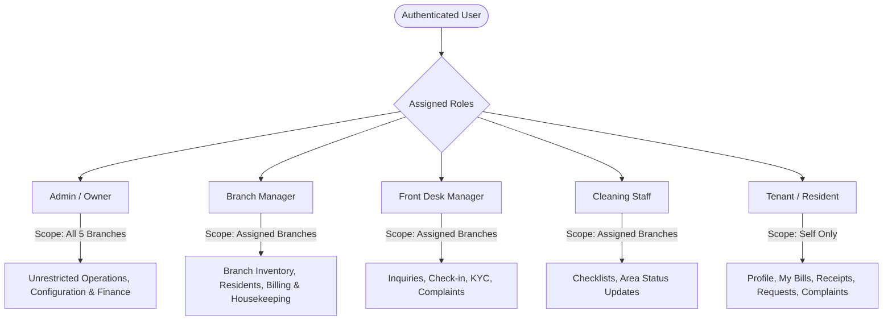
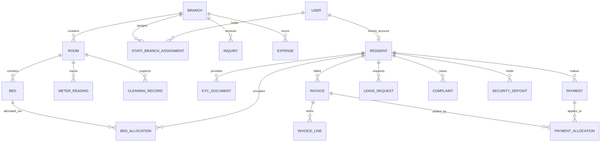

# Devnagari PG & Hostel — Master Project Specification

> **Document Status:** Active Specification  
> **Source Baseline:** Claude Artifact Inspection (`LkP4mzGX64KWyjk92beX8H`) & Approved Architecture Blueprint  
> **Target Stack:** Modular Monolith — React (TypeScript, Vite) + Java (Spring Boot) + PostgreSQL (Flyway)  
> **Last Updated:** 2026-10-21  

---

## 1. Project Overview and Scope

### 1.1 Purpose
**Devnagari PG & Hostel Management System** is an enterprise-grade property management application designed to centralize and automate end-to-end operations for student and working-professional accommodations across multiple branches.

### 1.2 Core Capabilities
1. **Multi-Branch Operations:** Centralized administrative visibility with strictly scoped branch-level operational boundaries across 5 active branches in Gandhinagar / Raysan.
2. **Bed-Level Inventory Management:** Real-time tracking of individual bed allocations, room sharing categories (Single, 2-Sharing, 3-Sharing, 4-Sharing), and climate control tiers (AC / Non-AC).
3. **Resident Lifecycle:** Lead generation and inquiry tracking, KYC document verification, room check-in, room transfers, leave of absence requests, and exit/settlement workflows.
4. **Financial Accounting & Reconciliation:** Strict separation of rental obligations (invoices), incoming cash/digital transactions (payments), allocations, late penalty fees, security deposits, electricity meter billing, operational expenses, and petty cashbook entries.
5. **Operational Facility Care:** Daily housekeeping area checklists, room maintenance tracking, and tenant complaint ticketing.
6. **Multi-Portal Access:** Integrated staff portal for administrative, front-desk, and housekeeping teams, alongside a resident-facing tenant portal for self-service bill payments, receipts, leave requests, and service tickets.

### 1.3 Active Branches in Scope **[Confirmed]**
| Branch Code | Branch Name | Gender / Target | Current Rooms | Total Beds | Current Occupancy |
| :--- | :--- | :--- | :--- | :--- | :--- |
| `SEC-08B` | **Devnagari Sector 8B** | Boys | 3 rooms | 7 beds | 50% (3/6 or 3/7) |
| `SEC-01G` | **Devnagari Sector 1 Girls** | Girls | 2 rooms | 6 beds | 67% (4/6) |
| `SEC-317G` | **Devnagari 317 Sector 8B Girls** | Girls | 2 rooms | 4 beds | 75% (3/4) |
| `ASH-RAY` | **Devnagari Aashka Raysan** | Boys | 2 rooms | 7 beds | 29% (2/7) |
| `KOB-RAY` | **Devnagari Koba Raysan** | Boys | 2 rooms | 7 beds | 29% (2/7) |
| **Total** | **5 Branches** | — | **11 Rooms** | **30 Beds** | **14 Occupied (46.7%)** |

---

## 2. Inspected Frontend Pages, Screens, and Workflows

All observations below are derived directly from live inspection of the reference web application artifact:

### 2.1 Authentication & Profile Switcher (`/login`) **[Confirmed]**
* **Split Layout:** Left hero panel illustrating brand identity ("Manage all 5 branches from one place"), value metrics (5 Branches, 1–6 Sharing, AC/Non-AC), and right card containing auth forms.
* **Portal Toggle:** Tabs to switch between **Staff Login** and **Tenant Login**.
* **Demo Persona Fillers:**
  * `Admin (Owner)`: All 5 branches — full system access (`Rajesh Patel`).
  * `Manager`: Sector 8B — full branch operations.
  * `Manager (Front desk)`: Girls branches (Sector 1 & 317 Sector 8B) — limited front-desk access.
  * `Cleaning staff (Sector 8B)`: Sector 8B daily cleaning checklist.
  * `Cleaning staff (Koba)`: Koba Raysan daily cleaning checklist.

### 2.2 Global Top Bar & Shell Navigation **[Confirmed]**
* **Universal Resident Search:** Auto-complete query input searching resident name, mobile number, room number, or customer ID.
* **Global Branch Switcher:** Persistent dropdown selector supporting `All 5 branches` or individual branch filtering.
* **Notification Bell:** Popover notification tray for dues alerts, leave approvals, and complaint alerts.
* **Quick Action Button:** Prominent `+ New Check-in` trigger.
* **User Profile Anchor:** Displays initials, name, and role badge (`RP - Rajesh Patel · Admin / Owner`).

### 2.3 Dashboard (`/dashboard`) **[Confirmed]**
1. **Available Bed Revenue Card:** Displays gross potential revenue from vacant beds (`₹67,500/month` across available inventory). Provides branch-level subtotals:
   * Sector 8B: 1 bed · ₹6,500
   * Sector 1 Girls: 2 beds · ₹15,500
   * Aashka Raysan: 5 beds · ₹27,500
   * Koba Raysan: 4 beds · ₹18,000
   * Quick link: `See available beds`.
2. **Inventory & Billing Summary:** 
   * Tracks monthly billing metrics: 18 total bills, 9 paid/closed, 9 pending bills, ₹54.3K paid, ₹50.9K pending dues, ₹64.2K expenses.
   * Progress bar indicating % of month's obligations closed, including overdue penalties (₹1,000 recorded).
   * Quick link: `Open dues`.
3. **Housekeeping Daily Progress:**
   * Summarizes cleaning status (4 of 10 rooms fully cleaned · 37/65 designated areas cleaned = 57% completion).
   * Branch bars: Sector 8B (55%), 317 Sector 8B Girls (69%), Koba Raysan (33%), Sector 1 Girls (62%), Aashka Raysan (54%).
   * Discrepancy warning pill: `2 area(s) reported not clean`.
4. **Collection vs Expenses History:**
   * 6-month comparative bar chart (May – Oct) charting gross rental collection (excl. security deposits) against operational expenditure.
5. **Payment Modes Breakdown:**
   * Donut chart breakdown: Total ₹62.3K (UPI: ₹47.0K, Bank Transfer: ₹10.8K, Cash: ₹4.5K, Other: ₹0).
   * Demographic tenant distribution: 8 Students, 6 Working Professionals.

### 2.4 Front Desk Module (`/front-desk/*`) **[Confirmed]**
* **Inquiries (`/inquiries`):**
  * Stage metric pills: Total inquiries (6), New (1), Follow-ups (1), Visits scheduled (2), Visits completed (1), Booked (1).
  * Filter pills: `Open`, `New`, `Follow-up`, `Visit Scheduled`, `Visit Completed`, `Booked`, `Lost`, `All`.
  * Lead record attributes: Lead Name, Inquiry ID (`INQ-0000x`), Mobile (+91...), Target Branch, Room preference (AC / Non-AC), Source (Walk-in, Reference, WhatsApp, Website), Scheduled Next Step (e.g., "Call on 21 Oct", "Visit on 23 Oct"), Status tag, and Call / Update CTA triggers.
  * Automated WhatsApp / SMS templates drawer.
* **New Check-in (`/check-in`):** Guided wizard capturing resident demographic details, parent/guardian contact, emergency contact, college/employer verification, room/bed assignment, rent schedule, and initial deposit receipt.
* **KYC Documents (`/kyc`):** Document verification tray with status badges (`Pending` [5], `Verified`, `Rejected`).
* **Leave Requests (`/leave`):** Tenant absence applications capturing departure date, expected return date, reason, and emergency contact details (3 pending approvals).
* **Check-outs (`/check-out`):** Tenant checkout settlement workflow, damage assessment, room handover checklist, and security deposit refund calculation.

### 2.5 Residents & Inventory Module (`/residents/*`) **[Confirmed]**
* **Resident Roster (`/residents`):**
  * Sub-filters: `Staying now` (14 active), `Checked-out`, `All`.
  * Multi-attribute filtering: Keyword search, Resident Type (`Student` vs `Working Professional`), KYC status, Dues status.
  * Columns: Customer ID (`DH-CUS-0000x`), Resident Name, Room & Bed tag (e.g. `101-B [AC]`), Branch name, Type, Agreed Rent, Next Due Date, KYC badge, Current Pending Dues balance.
* **Rooms & Beds Inventory (`/rooms`):**
  * Top metrics: Total Beds (30 across 11 rooms), Occupied (14 · 47%), Available (13), Reserved / Repair (3).
  * Inventory Filters: All rooms, With free bed (13), Maintenance (1), Reserved (2), AC/Non-AC filter, Sharing category dropdown.
  * View toggles: **Bed Map View** (visual floor plan) vs **List View**.
  * Card visualization: Displays Room Number, Floor, AC badge, Sharing badge, Rent per bed/month, Amenities (Wi-Fi, Wardrobe), and individual bed state badges:
    * *Occupied* (Dark/Solid with occupant first name)
    * *Available / Free* (Green outline with `Free` label)
    * *Reserved* (Yellow outline with `Reserved` label)
    * *Maintenance* (Orange outline with wrench icon)
* **Room Transfers (`/transfers`):** Workflow to move a resident from Bed X to Bed Y, handling rent adjustments and deposit transfers while preserving historical occupancy.
* **Housekeeping (`/cleaning`):** Area-wise daily cleaning checklists (Bathrooms, Corridors, Bedrooms, Kitchen).
* **Complaints (`/complaints`):** Service desk tracking issue description, priority, category (Plumbing, Electrical, Wi-Fi, Furniture), assigned staff, and resolution lifecycle.

### 2.6 Payments & Finance Module (`/payments/*`) **[Confirmed]**
* **Payments & Dues (`/payments`):**
  * Sub-tabs: `Dues` vs `Collections`.
  * Overview cards: Overdue (`₹27.1K` across 5 dues), Due Today (`₹18.9K` across 3 dues), Partially Paid (`₹5.0K` · 1 balance), Upcoming (10 days: `₹0`).
  * Action button: `₹ Collect payment`.
  * Overdue penalty rule: Fixed penalty charges automatically attached to overdue rental balances (e.g., `+ ₹200 overdue charge`).
  * Item table: Resident name, Room/Branch, Charge Type (`Rent`, `Electricity`, `Check-in Balance`), Due Date, Status, Last Reminder timestamp, Net Balance, `Remind` (WhatsApp/SMS) and `Collect` buttons.
* **Receipts (`/receipts`):** Numbered transaction receipts, invoice mapping, print/PDF export.
* **Electricity Management (`/electricity`):** Sub-meter reading logs per room/floor, consumption units calculation, tariff rates, and resident division logic.
* **Cash Book (`/cash-book`):** Daily petty cash transactions, cash collections, vouchers, and cash drawer reconciliations.

### 2.7 Reports Module (`/reports/*`) **[Confirmed]**
* **Tabs:** `Occupancy`, `Collections`, `Pending dues`, `Profit & Loss`.
* **Occupancy Table:** Branch-level breakdown of AC Beds, Non-AC Beds, Vacant Beds, Occupancy progress bar, and percentage, with CSV export.
* **Room Type Distribution:** Breakdown of bed counts across Single, 2-Sharing, 3-Sharing, and 4-Sharing per branch.

---

## 3. Confirmed Business Requirements

1. **Strict Branch Scoping:** Staff members must only view and operate on data for branches explicitly assigned to them. Only `Admin/Owner` can execute cross-branch operations.
2. **Atomic Bed Inventory:** A bed is the fundamental unit of occupancy. Overbooking or concurrent assignment of the same bed is strictly prohibited at the database level.
3. **Tenant Residency History Preservation:** Room transfers and departures must not overwrite prior residency history. An allocation record must be closed with an end-date and reason, creating a new allocation record for any subsequent bed.
4. **Independent Financial Tracking:**
   * An **Invoice** represents a financial obligation.
   * A **Payment** represents funds received via a specific channel (UPI, Cash, Bank Transfer).
   * A **Payment Allocation** maps a payment to one or more invoices.
   * **Security Deposits** must be isolated in a dedicated liability account and not treated as monthly rental revenue.
5. **Overdue Penalties:** Invoices past their grace period automatically accrue predefined late fees (e.g. ₹200). Late fee waivers require authorized staff approval and audit logging.
6. **Electricity Allocation:** Sub-meter readings generate electricity obligations that are apportioned equally among all active residents occupying that specific room during the billing window.
7. **Documented KYC Compliance:** A resident cannot transition into full active standing without submitted identity documents (Aadhaar / National ID / Student ID).

---

## 4. User Roles and Permissions



### 4.1 Permission Matrix **[Confirmed]**

| Capability / Resource | Admin (Owner) | Branch Manager | Front Desk | Cleaning Staff | Tenant |
| :--- | :---: | :---: | :---: | :---: | :---: |
| **All Branches Visibility** | Yes | No (Assigned) | No (Assigned) | No (Assigned) | No |
| **Create / Edit Branches & Rooms** | Yes | No | No | No | No |
| **Lead & Inquiry Management** | Yes | Yes | Yes | No | No |
| **Resident Check-in & KYC Approval** | Yes | Yes | Yes | No | No |
| **Room / Bed Allocation & Transfers** | Yes | Yes | Yes | No | No |
| **Collect Payments & Issue Receipts** | Yes | Yes | Read-Only | No | Pay Own |
| **Apply / Waive Late Fee Penalties** | Yes | Approval Req. | No | No | No |
| **Record Operational Expenses** | Yes | Yes | No | No | No |
| **Electricity Meter Reading Entry** | Yes | Yes | Yes | No | No |
| **Housekeeping Checklist Update** | Yes | Yes | Read-Only | Yes | No |
| **Resolve Tenant Complaints** | Yes | Yes | Yes | No | File Own |
| **Approve Tenant Leaves** | Yes | Yes | Yes | No | Request Own |
| **Financial Reports & P&L Export** | Yes | Branch Only | No | No | No |

---

## 5. Business Entities and Their Responsibilities

| Domain Entity | Module | Core Responsibilities |
| :--- | :--- | :--- |
| `Branch` | `branch` | Represents a physical property. Owns rooms, gender policies, and operational rules. |
| `Room` | `accommodation`| Physical room belonging to a branch. Governs floor number, sharing capacity, AC status. |
| `Bed` | `accommodation`| Discrete sleeping unit within a room. Tracks real-time availability and maintenance states. |
| `BedAllocation` | `accommodation`| Temporal assignment linking a resident to a bed from `startDate` to `endDate`. |
| `Resident` | `resident` | Demographic profile of an individual tenant, emergency contacts, customer ID. |
| `KycDocument` | `resident` | Uploaded identity verification records and staff validation audit. |
| `Inquiry` | `inquiry` | Prospective resident lead, pipeline stage, communication log, visit schedules. |
| `Invoice` | `billing` | Financial obligation for rent, electricity, maintenance, or check-in balance. |
| `InvoiceLine` | `billing` | Line item breakdown of an invoice (e.g. Base Rent, Late Fine, Electricity units). |
| `Payment` | `payment` | Financial transaction record capturing amount received, payment method, and transaction ref. |
| `PaymentAllocation` | `payment` | Maps monetary amounts from a payment to settle specific invoice lines. |
| `SecurityDeposit`| `billing` | Deposit liability ledger tracking initial collection, deductions, and exit refunds. |
| `MeterReading` | `electricity` | Period meter readings recording initial/final units and tariff rates per room. |
| `CleaningRecord` | `housekeeping` | Daily inspection checklist records per designated room/area with failure notes. |
| `Complaint` | `complaint` | Service ticket raised by a tenant or staff with priority, category, and resolution log. |
| `LeaveRequest` | `leave` | Absence notice filed by tenant with departure/return dates and emergency contacts. |
| `Expense` | `expense` | Operating cost recorded by staff (supplies, repairs, utilities) with receipt attachment. |
| `AuditEvent` | `shared` | Immutable append-only log capturing user actions, financial overrides, and state changes. |

---

## 6. Entity Relationships and Cardinality



---

## 7. Database Design, Normalization, and Data Integrity Rules

### 7.1 Normalization Baseline
* Database schemas must satisfy **Third Normal Form (3NF)** at minimum.
* Calculated and aggregated metrics (e.g., total overdue balance, branch occupancy percentage) must be computed dynamically in queries or read-optimized projections, never stored as mutable raw columns in core transactional tables.

### 7.2 Concurrency & Double-Booking Protection **[Critical]**
To eliminate race conditions when two front-desk managers attempt to allocate the same bed simultaneously:
1. **PostgreSQL Exclusion Constraints:** Use `btree_gist` extension to enforce non-overlapping allocation time ranges:
   ```sql
   ALTER TABLE bed_allocations 
   ADD CONSTRAINT no_overlapping_bed_stays 
   EXCLUDE USING gist (
       bed_id WITH =,
       tstzrange(start_date, COALESCE(end_date, 'infinity'::timestamptz)) WITH &&
   ) WHERE (status IN ('ACTIVE', 'RESERVED'));
   ```
2. **Pessimistic Locking:** Application services must acquire a pessimistic write lock (`SELECT ... FOR UPDATE`) on the target `Bed` entity during check-in and transfer transactions.

### 7.3 Financial Integrity Constraints
1. **No Floating-Point Currency:** All monetary columns must use PostgreSQL `NUMERIC(12, 2)` and Java `BigDecimal`.
2. **Allocation Invariants:** The sum of `PaymentAllocation` records linked to an invoice cannot exceed `Invoice.total_amount`. The sum of allocations linked to a payment cannot exceed `Payment.amount`.
3. **Immutability of Financial Records:** Invoices and payments are append-only. Adjustments, cancellations, or refunds must be registered as new balancing entries (`CreditNote`, `PaymentRefund`), never via direct SQL `UPDATE` or `DELETE` on finalized records.

---

## 8. Database Tables & Architecture (Flyway V1 Full Parity Baseline)

The database schema is fully defined in [`apps/api/src/main/resources/db/migration/V1__initial_schema.sql`](file:///Users/dev/P_PROJECT/DEVNAGRI/apps/api/src/main/resources/db/migration/V1__initial_schema.sql) and documented in detail in [`docs/architecture/domain-model.md`](file:///Users/dev/P_PROJECT/DEVNAGRI/docs/architecture/domain-model.md). All 8 domains and ~55 tables are approved:

### 8.1 Domain Table Catalog
* **1. Organization & Configuration:** `hostel_settings`, `branches`, `amenities`, `branch_amenities`, `sharing_types`, `room_item_types`, `cleaning_checklist_items`, `vendor_categories`, `message_templates`, `inquiry_followup_templates`, `faqs`, `branch_help_infos`, `document_sequences`.
* **2. Identity & Access:** `staff_users`, `staff_user_branches`, `permissions`, `staff_user_permissions`, `customers`, `otp_challenges`, `auth_sessions`.
* **3. Inventory (Property → Room → Bed):** `rooms`, `room_amenities`, `beds`, `bed_reservations`, `room_cleaning_exclusions`, `inventory_items`, `inventory_item_events`.
* **4. Residency Lifecycle:** `stays`, `bed_allocations` (with exclusion constraint), `kyc_documents`, `leave_requests`, `room_transfers`, `check_outs`, `check_out_deductions`, `customer_notes`, `terms_versions`, `terms_sections`, `terms_acceptances`.
* **5. Billing & Money:** `charges`, `charge_adjustments`, `payments`, `payment_allocations`, `online_payment_orders`, `online_payment_order_charges`, `pay_links`, `customer_credit_entries`, `meter_readings`, `electricity_shares`, `cash_book_entries`, `offers`, `offer_branches`, `offer_claims`, `referrals`.
* **6. Facility Operations:** `complaints`, `complaint_photos`, `complaint_events`, `cleaning_records`, `cleaning_record_items`, `cleaning_verifications`, `vendors`, `expenses`, `expense_payments`.
* **7. CRM & Leads:** `inquiries`, `inquiry_notes`, `room_links`, `room_link_rooms`, `outbound_messages`.
* **8. Communication & Audit:** `announcements`, `announcement_targets`, `customer_notifications`, `staff_notifications`, `staff_notification_reads`, `activity_logs`, `stored_files`.


---

## 9. Business Rules by Domain

### 9.1 Bookings, Allocations & Transfers
1. **Deposit Prerequisite:** A bed can be placed into `RESERVED` status for up to 72 hours upon receipt of an advance booking deposit. If check-in is not completed within 72 hours, the reservation lapses.
2. **Transfer Rule:** When a resident transfers from Room A (Bed 1) to Room B (Bed 2):
   * Existing `BedAllocation` for Bed 1 is closed with `endDate = transferDate` and `reason = TRANSFER`.
   * New `BedAllocation` for Bed 2 is created with `startDate = transferDate`.
   * Rent differential is prorated and billed/credited on the next invoice cycle.

### 9.2 Billing & Payments
1. **Billing Cycle:** Invoices are generated on the 1st of each calendar month or on the resident's monthly anniversary.
2. **Grace Period & Late Fees:** A 5-day grace period is granted. Invoices unpaid after the due date automatically attach a ₹200 overdue penalty line item.
3. **Payment Allocation Precedence:** Payments are applied in the following order unless explicitly overridden by staff:
   1. Unpaid Late Penalties
   2. Unpaid Electricity Obligations
   3. Oldest Outstanding Rent Invoices

### 9.3 Electricity Sub-Metering
1. Rooms with private air conditioning have independent sub-meters.
2. Monthly bill = `(Current Reading - Previous Reading) * Rate Per Unit`.
3. Total calculated room obligation is split equally among all active residents assigned to that room during the billing window.

---

## 10. Expected REST API Operations & Integration

| HTTP Method | Path | Summary | Authorization Scope |
| :--- | :--- | :--- | :--- |
| `POST` | `/api/v1/auth/login` | Authenticate user, return JWT + permissions | Public |
| `GET` | `/api/v1/branches` | List authorized branches for the caller | Authenticated |
| `GET` | `/api/v1/dashboard/summary` | Retrieve branch-filtered KPIs and metrics | Staff |
| `GET` | `/api/v1/inquiries` | List and search inquiries with stage filters | Front Desk / Manager |
| `POST` | `/api/v1/inquiries` | Create new inquiry lead | Front Desk / Manager |
| `PATCH` | `/api/v1/inquiries/{id}/status`| Progress inquiry status (Visit, Booked, Lost) | Front Desk / Manager |
| `GET` | `/api/v1/residents` | Query residents roster with filters | Staff |
| `POST` | `/api/v1/residents/check-in` | Atomic resident check-in + bed allocation | Front Desk / Manager |
| `POST` | `/api/v1/residents/{id}/transfer` | Execute room transfer | Front Desk / Manager |
| `POST` | `/api/v1/residents/{id}/checkout` | Process resident checkout and settlement | Manager / Admin |
| `GET` | `/api/v1/rooms/inventory` | Live bed map and room status | Staff |
| `GET` | `/api/v1/billing/invoices` | List invoices with dues/overdue status | Staff / Tenant (Self) |
| `POST` | `/api/v1/billing/payments` | Record incoming payment & allocate to invoices | Manager / Admin |
| `GET` | `/api/v1/electricity/readings` | View room sub-meter readings | Staff |
| `POST` | `/api/v1/electricity/readings` | Record new monthly meter reading | Staff |
| `GET` | `/api/v1/housekeeping/checklist`| Daily cleaning checklist by branch | Cleaning / Staff |
| `PATCH` | `/api/v1/housekeeping/checklist/{id}`| Toggle area cleaning completion | Cleaning / Staff |
| `GET` | `/api/v1/complaints` | List open service tickets | Staff / Tenant (Self) |
| `POST` | `/api/v1/complaints` | File new complaint ticket | Staff / Tenant |
| `GET` | `/api/v1/reports/occupancy` | Retrieve occupancy aggregates (CSV export) | Manager / Admin |

---

## 11. Validation Rules and Error Scenarios

| Scenario | Trigger / Condition | Expected System Behavior | HTTP Status |
| :--- | :--- | :--- | :---: |
| **Double Booking** | Check-in or transfer targets an already occupied or reserved bed | Transaction rolled back with `BED_ALREADY_OCCUPIED` error code | `409 Conflict` |
| **Cross-Branch Violation** | Staff user requests data for an unassigned branch ID | Request intercepted by security policy, logged to audit log | `403 Forbidden` |
| **Invalid Payment Allocation** | Sum of allocated amounts exceeds payment received | Validation fails with `PAYMENT_ALLOCATION_OVERFLOW` | `422 Unprocessable` |
| **Missing KYC at Check-in** | Attempting active check-in without required identity docs | Blocked unless marked with explicit `PROVISIONAL_OVERRIDE` | `400 Bad Request` |
| **Meter Reading Inconsistency**| `current_units` < `previous_units` without meter reset flag | Blocked with `INVALID_METER_READING_SEQUENCE` | `400 Bad Request` |

---

## 12. Security, Privacy, and Data Retention

1. **Authentication & Token Handling:** Stateless JWT with short expiration (15 mins) and secure HTTP-only refresh tokens.
2. **Field-Level Privacy:** Tenant Aadhaar numbers and sensitive identity documents must be encrypted at rest (AES-256) and masked in standard API responses (`XXXX-XXXX-1234`).
3. **Data Retention:** Checkout settlement records and invoices must be retained for a statutory minimum of 7 years for financial compliance.
4. **Audit Logging:** Any update to payment records, fee waivers, or manual room reallocations automatically produces an append-only `AuditEvent`.

---

## 13. Technology Decisions (Architecture Decision Records)

* **ADR-001 (Monorepo Architecture):** React (TypeScript) and Java (Spring Boot) housed in a unified monorepo to enable synchronous contract verification.
* **ADR-002 (Modular Monolith):** Single deployable backend artifact structured with strict business package boundaries. Microservices rejected as premature.
* **ADR-003 (PostgreSQL & Flyway):** Flyway manages all relational database migrations. Hibernate `ddl-auto` is strictly set to `validate`.
* **ADR-004 (OpenAPI Canonical Contract):** `contracts/openapi.yaml` acts as the single source of truth for frontend API client generation and backend controller validation.
* **ADR-005 (Server-Enforced Branch Scope):** Security policies validate branch scope in service layer queries (`WHERE branch_id IN (:userBranchIds)`), not relying on frontend filters.
* **ADR-006 (Monetary Precision):** Strict prohibition of floating point types for finance (`BigDecimal` and `NUMERIC(12,2)`).

---

## 14. Assumptions, Discrepancies, and Unresolved Questions

### 14.1 Identified UI Data Discrepancies **[Pending Verification]**
1. **Available Bed Count vs. Revenue Metric:**
   * In the reference UI, Bed Map shows: 30 beds (14 Occupied, 13 Available, 3 Reserved/Maintenance).
   * **Approved Resolution:** Real backend calculates available revenue dynamically using active catalog room rent for beds in `AVAILABLE` status.
2. **Cleaning Areas vs. Room Count:**
   * **Approved Resolution:** Structured as `cleaning_checklist_items` (Bedrooms, Bathrooms, Balconies, Common Areas) with room-specific exclusions (`room_cleaning_exclusions`), enabling flexible multi-zone checklists per room.
3. **API Contract & Frontend Migration:**
   * **Approved Resolution:** We design best-fit, clean RESTful domain services in the Spring Boot backend. Controllers expose clean endpoints, and agents align the React frontend client to this standardized API.
4. **Schema Parity Scope:**
   * **Approved Resolution:** Full Parity upfront. All 8 domains and ~55 tables implemented in the baseline Flyway migration (`V1__initial_schema.sql`).
5. **Aadhaar Compliance Standard:**
   * **Approved Resolution:** In strict compliance with UIDAI regulations, raw 12-digit numbers are never stored in plain text. Store masked number (`XXXX-XXXX-1234`) with uploaded document scans in secure object storage.
6. **Bed Reservation Entity:**
   * **Approved Resolution:** Explicit `bed_reservations` entity tracking reserving party, target move-in date, token deposit, and reservation validity window (`reserved_until`).
7. **Currency & Monetary Precision:**
   * **Approved Resolution:** All money columns use PostgreSQL `NUMERIC(12,2)` and Java `BigDecimal`. Fractional rupees (paise) are supported for electricity unit tariffs and pro-rata adjustments.

---

## 15. Document Change History

| Date | Version | Summary of Changes | Author |
| :--- | :---: | :--- | :--- |
| **2026-10-21** | `1.0.0` | Initial project specification compiled from Claude artifact inspection, domain boundaries, and architecture blueprint. | Antigravity AI |
| **2026-10-21** | `1.1.0` | Integrated Phase 1 & 2 frontend de-minification analysis; resolved 7 open questions; finalized 8-domain ~55-table Flyway V1 schema. | Antigravity AI |

