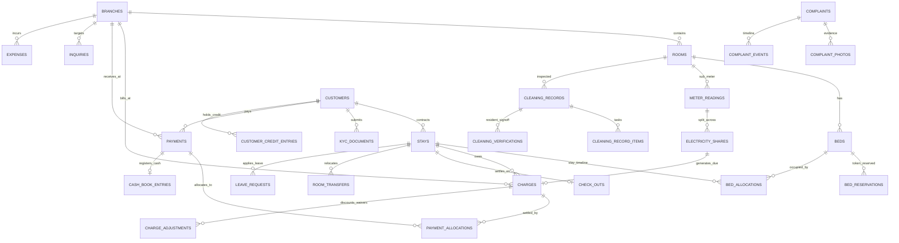

# Devnagari PG & Hostel — Domain Model & Data Dictionary (Phase 3)

> **Document Status:** Approved Architecture Standard  
> **Target Database Engine:** PostgreSQL 16+  
> **Schema Version:** Flyway `V1__initial_schema.sql` (Full Parity Baseline)  
> **Last Updated:** 2026-10-21  

---

## 1. Domain Organization Overview

The database schema is organized into **8 cohesive business domains**, completely replacing the client-side mock backend collections with a normalized relational model (3NF):

```
                               ┌────────────────────────────────┐
                               │  1. Organization & Config      │
                               │  (hostel_settings, branches)   │
                               └───────────────┬────────────────┘
                                               │
               ┌───────────────────────────────┼───────────────────────────────┐
               ▼                               ▼                               ▼
┌──────────────────────────────┐┌──────────────────────────────┐┌──────────────────────────────┐
│  2. Identity & Access        ││  3. Physical Inventory       ││  7. CRM & Leads              │
│  (staff_users, customers)    ││  (rooms, beds, reservations) ││  (inquiries, room_links)     │
└──────────────┬───────────────┘└──────────────┬───────────────┘└──────────────┬───────────────┘
               │                               │                               │
               └───────────────────────┬───────┴───────────────────────────────┘
                                       ▼
                        ┌──────────────────────────────┐
                        │  4. Residency Lifecycle      │
                        │  (stays, bed_allocations,    │
                        │   kyc_docs, transfers, exits)│
                        └──────────────┬───────────────┘
                                       │
               ┌───────────────────────┴───────────────────────┐
               ▼                                               ▼
┌──────────────────────────────┐                ┌──────────────────────────────┐
│  5. Billing & Money          │                │  6. Facility Operations      │
│  (charges, payments, allocs, │                │  (complaints, cleaning,      │
│   electricity, credit_ledger)│                │   vendors, expenses)         │
└──────────────────────────────┘                └──────────────────────────────┘
                               ▲                               ▲
                               └───────────────┬───────────────┘
                                               │
                               ┌───────────────┴────────────────┐
                               │  8. Communication & Audit      │
                               │  (notifications, logs, files)  │
                               └────────────────────────────────┘
```

---

## 2. Core Entity Relationship (ER) Diagram



---

## 3. Data Dictionary by Domain

### Domain 1: Organization & Configuration
1. **`hostel_settings`**: Global single-row configuration storing organizational legal identity, due date rules (`CHECK_IN_DATE` vs `FIXED_DAY_OF_MONTH`), grace period days, overdue charge policies, and notice period thresholds.
2. **`branches`**: Physical properties (`SEC-08B`, `SEC-01G`, `ASH-RAY`, etc.) with gender policies (`BOYS`, `GIRLS`, `CO_LIVING`), address, UPI IDs, base electricity tariff, and security deposit month multiples.
3. **`amenities` / `branch_amenities` / `room_amenities`**: Normalized catalog of facility amenities (Wi-Fi, AC, Attached Bath, Biometric Entry).
4. **`sharing_types`**: Master table defining bed capacities (`SINGLE` through `6_SHARING`).
5. **`room_item_types` / `cleaning_checklist_items`**: Masters defining room asset inventory and daily housekeeping cleaning checklist tasks.
6. **`document_sequences`**: Concurrency-safe counter tracking gap-free sequential numbers per branch and financial year for receipts (`DH/S8B/26-27/00001`), customer IDs, and complaint tickets.

### Domain 2: Identity & Access
1. **`staff_users`**: Administrative and operational accounts (`ADMIN`, `MANAGER`, `CLEANING_STAFF`) with BCrypt password hashes, contact details, and account status.
2. **`staff_user_branches`**: Explicit M:N mapping defining which branches a staff manager or cleaning staff member can access.
3. **`permissions` / `staff_user_permissions`**: Fine-grained authorization privileges (`resident.view`, `payment.discount`, `kyc.verify`, `checkout.approveRefund`).
4. **`customers`**: Tenant profiles containing customer code (`DH-CUS-00001`), full name, unique mobile phone, gender, occupation status (`STUDENT` vs `WORKING_PROFESSIONAL`), and emergency guardian contact info.
5. **`otp_challenges`**: Short-lived cryptographic OTP challenge records with attempt throttling and consumption flags for passwordless tenant login.
6. **`auth_sessions`**: Active session tokens with role tags and expiration timestamps.

### Domain 3: Inventory (Property → Room → Bed)
1. **`rooms`**: Physical rooms within a branch specifying floor, sharing category, AC status, and base catalog rent/deposit per bed.
2. **`beds`**: Individual sleeping units (`Bed A`, `Bed B`, `Bed C`). Contains **only manual operational statuses** (`AVAILABLE`, `RESERVED`, `MAINTENANCE`). The `OCCUPIED` state is dynamically derived from active stays.
3. **`bed_reservations`**: First-class booking entity capturing who reserved the bed, target joining date, reservation expiry (`reserved_until`), token deposit received, and conversion links.
4. **`inventory_items` / `inventory_item_events`**: Room fixtures (Wardrobes, Mattresses, Geysers, Study Tables) with condition tracking (`NEW`, `GOOD`, `DAMAGED`) and maintenance events.

### Domain 4: Residency Lifecycle
1. **`stays`**: Represents one complete residency contract between a customer and the hostel. Supports returning tenants (1 customer to N stays). A **partial unique index** enforces that a resident can have at most one active stay at any time.
2. **`bed_allocations`**: Temporal bed assignment record linking a stay to a specific bed, locking in agreed monthly rent and security deposit amounts. Protected against race conditions via PostgreSQL range exclusion constraints.
3. **`kyc_documents`**: Stores document type (`AADHAAR`, `PAN`, `PASSPORT`), masked document numbers (`XXXX-XXXX-1234` for UIDAI compliance), status (`PENDING`, `VERIFIED`, `REJECTED`), and object-storage links to front/back scans.
4. **`leave_requests`**: Tenant leave notices capturing departure and return dates, vacating notices, and snapshots of pending dues at request time.
5. **`room_transfers`**: Comprehensive room transfer lifecycle tracking quote snapshots (pro-rata rent delta, deposit delta, transfer fees), manager approvals, and allocation transitions.
6. **`check_outs` / `check_out_deductions`**: Final exit settlement (`FS/` sequence) recording final electricity meter reading, damage deductions, deposit refund mode, and net balance reconciliation.
7. **`terms_versions` / `terms_sections` / `terms_acceptances`**: Versioned terms and conditions with tenant digital signature/acceptance audit trail.

### Domain 5: Billing & Money
1. **`charges`**: Fundamental ledger of resident obligations (replaces mock "dues"). Types: `RENT`, `SECURITY_DEPOSIT`, `ELECTRICITY`, `TRANSFER_FEE`, `OVERDUE_CHARGE`. Status (`PAID`, `PARTIALLY_PAID`, `OVERDUE`) is derived dynamically.
2. **`charge_adjustments`**: Line-item ledger for waivers, manager discounts, and referral credits applied against charges.
3. **`payments`**: Immutable record of money received. Generates legal sequential receipt numbers (`DH/S8B/26-27/00005`), records payment mode (`UPI`, `CASH`, `BANK_TRANSFER`, `RAZORPAY`), and tracks owner verification status.
4. **`payment_allocations`**: M:N associative entity mapping specific payment amounts to specific charges. This guarantees precision for partial payments and multi-due receipts.
5. **`online_payment_orders` / `online_payment_order_charges`**: Idempotent order tracking for Razorpay checkout sessions, webhook reconciliation, and automated receipt issuance.
6. **`customer_credit_entries`**: Double-entry credit balance ledger tracking overpayments, transfer credits, and referral reward credits.
7. **`meter_readings` / `electricity_shares`**: Monthly room sub-meter readings and mathematical resident unit apportionment during active billing windows.
8. **`cash_book_entries`**: Physical cash receipt book register (`CR-` numbering) linking daily cash drawer takings to owner verification.
9. **`offers` / `offer_claims` / `referrals`**: Promotional discount system and resident referral pipelines.

### Domain 6: Facility Operations
1. **`complaints` / `complaint_photos` / `complaint_events`**: Service ticketing workflow (`CMP-00042`) supporting staff or external technician assignment, photo attachments, and resident confirmation/reopen periods.
2. **`cleaning_records` / `cleaning_record_items` / `cleaning_verifications`**: Daily per-room housekeeping task checklists with resident verification sign-off and automatic complaint ticket generation for uncleaned rooms.
3. **`vendors` / `expenses` / `expense_payments`**: Operational vendor bills and multi-stage expense disbursement tracking.

### Domain 7: CRM & Leads
1. **`inquiries` / `inquiry_notes`**: Prospective lead CRM tracking pipeline status (`NEW` → `FOLLOW_UP` → `VISIT_SCHEDULED` → `VISIT_COMPLETED` → `BOOKED` / `LOST`), scheduled next steps, and customer conversion.
2. **`room_links` / `room_link_rooms`**: Secure, random tokenized public URLs allowing prospects to view selected room details without login.
3. **`outbound_messages`**: Outbox for automated WhatsApp and SMS notifications (receipts, due reminders, follow-up templates).

### Domain 8: Communication & Audit
1. **`announcements` / `announcement_targets`**: Broadcast notifications targeted by branch, room, or individual resident.
2. **`customer_notifications` / `staff_notifications`**: In-app notifications with read tracking and unique deduplication keys.
3. **`activity_logs`**: System-wide immutable audit trail logging who performed which action on which resource.
4. **`stored_files`**: Object-storage metadata registry (UUID, MIME type, file size, storage bucket path).

---

## 4. Key Data Integrity & Concurrency Mechanisms

### 4.1 Bed Allocation Range Exclusion Constraint
```sql
ALTER TABLE bed_allocations 
ADD CONSTRAINT no_overlapping_bed_stays 
EXCLUDE USING gist (
    bed_id WITH =,
    tstzrange(start_date, COALESCE(end_date, 'infinity'::timestamptz)) WITH &&
) WHERE (status = 'ACTIVE');
```
* **Guarantee:** PostgreSQL will reject any transaction attempting to insert or update an active allocation that intersects with an existing active stay on the same bed.

### 4.2 One Active Stay per Customer
```sql
CREATE UNIQUE INDEX uq_customer_active_stay ON stays (customer_id) 
WHERE (status IN ('ACTIVE', 'NOTICE_GIVEN'));
```
* **Guarantee:** A resident cannot have multiple concurrent active stays. Past stays are closed with `status = 'CHECKED_OUT'`, preserving complete historical records.

### 4.3 Monetary Precision Standard
* All financial values are strictly typed as `NUMERIC(12,2)` (storing Indian Rupees with exact 2-decimal paise precision).
* Application domain models map these directly to Java `BigDecimal` with `RoundingMode.HALF_EVEN`. Floating point types are prohibited.
